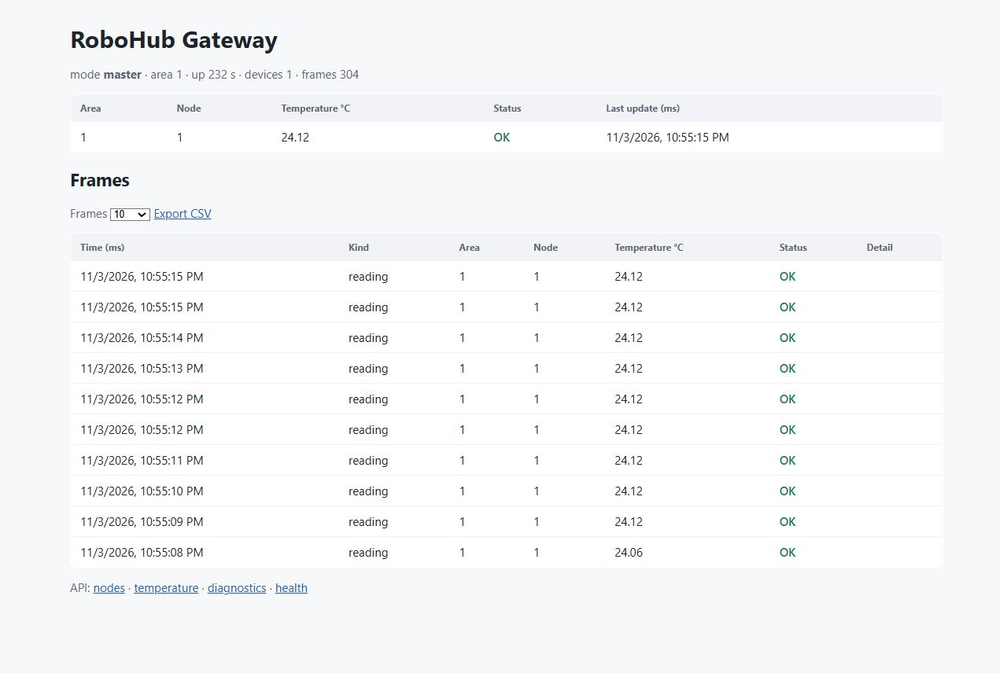

# robohub-gateway

The edge gateway for RoboHub firmware nodes.



A node writes telemetry as COBS frames over serial. The gateway reads them,
keeps each board's latest values where an HTTP client can read them, forwards
every reading to PlotJuggler over UDP, and answers a REST call that asks a node
to change its sampling rate — an RPC over the same link.

It is written in Rho and generated into a Go server by `rho build`. The only
host-side parts are the ones Rho cannot express, and they are one port: opening
the serial link, sending a datagram, reading a monotonic clock, remembering
which boards have been heard from, and holding the state a reader and an HTTP
handler share.

Mesh builds, deploys and reads its gateways: each Mesh project has one, started
with that project's settings (see {ref}`mesh/index`). Mesh ingests the
gateway's outbox into its telemetry store (see {ref}`mesh-telemetry/index`),
and applications read the readings from Mesh, never from the gateway directly.

## What it answers

Every route but `/healthz` needs a token (see [Access](#access) below).


- `GET /api/v1/telemetry/temperature` — the latest reading, from whichever device
  sent it last.

  ```json
  { "area_id": 7, "node_id": 1, "temperature_c": 24.38, "status": "OK", "last_updated_ms": 186095 }
  ```

- `GET /api/v1/nodes` — every device a frame has come from, each with its newest
  values. A reading names its own device — an area and a node — so two boards
  numbered 2 in different areas are two devices.

- `GET /api/v1/telemetry/power`, `GET /api/v1/telemetry/state` — the newest
  power reading and device state, from whichever device sent it last.

- `GET /api/v1/diagnostics` — what the gateway itself is doing: the mode it was
  deployed in, the area it speaks for, its uptime and what it has carried.

- `GET /api/v1/nodes/{area}/{node}/diagnostics` — asks one device to run its
  hardware smoke and records the answer with the device.

- `POST /api/v1/nodes/{area}/{node}/sampling-rate`, `…/switch`, `…/command` —
  a control sent to a named device: its reporting interval, a switch (on or
  off), or any opcode and argument (a device's own opcodes start at the vendor
  base, so they cannot collide with a core one). A device in a child gateway's
  area is reached down that child's uplink.

- `POST /api/v1/devices` — register a network device (name, kind, transport,
  address, device id). The id is the device's stable identity: a client that
  knows the hardware id passes it, one that does not gets `transport:address`,
  and a second registration of the same id is refused rather than becoming a
  second series.
- `GET /api/v1/devices` — the registered devices and their latest state.
- `POST /api/v1/devices/{id}/poll` — read an HTTP device's status.
- `POST /api/v1/devices/{id}/switch` — switch an HTTP device on or off; the
  state may come as a form field or as `?state=on|off`.
- `POST /api/v1/frames` — accepts one encoded frame from a network bridge. A
  Shelly or another IP device reaches the gateway through a relay or a small
  poller; the frame is the same one a serial link carries, so it lands in the
  same device record and stream.
- `POST /api/v1/telemetry/sampling-rate` — an RPC that changes a node's
  reporting interval, answered `200` with the node's acknowledgement or `504`
  when the node does not reply in time. A node may clamp the interval it can
  meet and reports what it actually set.

- `GET /` — the gateway page: mode, area, uptime, devices, frames, the latest
  values per node, and a frame history whose first row is newest. A node's
  `last_updated_ms` is its own uptime; the gateway's wall-clock
  `received_at_ms` is recorded beside it, and the page renders that locally. The history
  window is `/frames/{10|25|50|100|500|1000}`; `/export/frames/<count>/csv`
  exports it. Every node record carries both `last_updated_ms` (the node's
  uptime) and the gateway's wall-clock `received_at_ms`.
- `POST /api/v1/uplink/pump` — drains what has arrived on the uplink and says
  how many frames it applied.
- `GET /healthz` — a liveness probe, registered for every service, and the one
  route that needs no token.

## What it emits

Each valid telemetry frame becomes one newline-delimited JSON object on the UDP
collector, naming the device it came from:

```json
{"area_id":7,"node_id":1,"timestamp_ms":186095,"temperature_c":24.38,"status":0}
```

## The wire

A frame is robohub-transport's, the same one a C firmware node writes: a six-byte
header (`msg_id`, `tx_id`, `payload_len`), the payload, and a Fletcher-16 check,
COBS-encoded and closed with a `0x00` delimiter. The payloads and the framing in
this gateway are generated from `schemas/gateway.rho`, which includes the same
`common.rho` and `link.rho` a board's C is generated from, so the two ends are
one description.

## A Pico as the gateway

A Pico 2W can be the gateway itself. The `robohub-drivers` example
`examples/gateway/c/repeater` is the measuring node plus a downstream UART:
boards wired to it publish the same `Telemetry` event, and the readings stream
up the USB CDC — to this program when a host is present, or to whatever listens
when there is not.

## Configuration

| Variable | Default | Meaning |
|---|---|---|
| `SERIAL_PORT` | `/dev/ttyACM0` | the node's serial device |
| `SERIAL_BAUD` | `115200` | the line speed |
| `PLOTJUGGLER_ADDR` | `127.0.0.1:9870` | the UDP collector, `host:port` |
| `REST_PORT` | `8080` | the REST listener, a port; `RHO_HTTP_ADDR` overrides it |
| `GATEWAY_MODE` | `master` | `node`, `edge`, `relay` or `master` |
| `GATEWAY_AREA` | `1` | the area this gateway speaks for, and numbers its devices in |
| `UPLINK_PORT` | `0` | the TCP port the gateways below (and boards on Wi-Fi) dial in on; `0` listens on none |
| `UPLINK_BIND` | every interface | the address the uplink listens on: `127.0.0.1` for this machine only, or one LAN interface's address |
| `PARENT_UPLINK` | unset | for `relay`: the parent's uplink, `host:port`, which this gateway dials |
| `RELAY_UID` | unset | for `relay`: its id as a board of the parent's mesh, 16 hex digits |
| `RELAY_KEY_FILE` | unset | for `relay`: the key the parent derives for that id, 32 hex digits, in a file only its user reads |
| `OUTBOX_PATH` | `~/.rho/robohub/gateway-outbox.jsonl` | the durable reading feed |
| `OUTBOX_MAX_ROWS` | `200000` | how many unacked readings are retained before the oldest are dropped |
| `GATEWAY_ID` | `default` | this gateway's id; a caller's token must carry `gateway:<id>:read` or `gateway:<id>:command` |
| `RHO_AUTH_PUBLIC_KEY` | `~/.rho/auth/public.pem` | keeper's public key, which verifies every caller's token |
| `GATEWAY_KEY_FILE` | unset | this gateway's key (64 hex digits, owner-only); each board's key is derived from it and the board's id |
| `GATEWAY_SESSION_FILE` | `sessions` beside the key | where live board sessions are kept across a restart, owner-only |
| `ALLOW_PLAIN_FRAMES` | unset | `1` accepts unauthenticated frames from boards not yet reflashed, with a warning; unset drops them |
| `RHO_TLS_CERT`, `RHO_TLS_KEY` | unset | a certificate and key: with both, the API is served over HTTPS (see [TLS](#tls)) |

When Mesh deploys a gateway it sets these itself: `GATEWAY_ID` to the project's
id, the mode, the area, the ports, the key file, and the TLS pair when the
project names one.

## The telemetry outbox

The gateway is also the edge recorder. Every accepted reading is normalized to
one record per signal — a `PowerReading` becomes one record per valid field, a
`StateReading` one per valid state, a `SensorReading` one for the field it
names — and appended to a durable outbox with a per-gateway sequence.

An aggregator reads a page, commits it, and acknowledges the sequence, which is
what lets the gateway prune:

- `GET /api/v1/telemetry/outbox?after=<seq>&limit=<n>` — the readings after
  `after`, at most `limit` (default 500). A record is
  `{"seq","source","area_id","node_id","field","value","status","received_ms"}`,
  where `source` is the board that sent it, by the id its session was opened
  with. A reading that arrived unauthenticated, or from a gateway below, has
  none, and the store places it by area and node.
- `POST /api/v1/telemetry/ack` — `{"seq": n}`; removes what the aggregator has
  committed and records the floor so a restart does not replay it.
- `GET /api/v1/telemetry/outbox/status` — `path`, `depth`, `base_seq`,
  `last_seq` and `dropped`.

The sequence continues across a restart, including after the outbox has been
emptied, and a repeated page is harmless: the aggregator keys a reading by
gateway and sequence. The file is written through a buffered writer and synced
every two seconds or every hundred readings, so a board's eMMC sees batches
rather than one write per sample. `OUTBOX_MAX_ROWS` bounds what is kept when no
aggregator is reachable; the oldest records are dropped and counted.

The same feed carries a network device the gateway polls. A Shelly's state and
power are written as `state` and `power_w` under the gateway's own device id, so
the history exists before the device is folded into a plan.

## Relay mode

A gateway with `GATEWAY_MODE=relay` and `PARENT_UPLINK` set reports through its
parent: it is how one mesh is linked under another. The relay is a board of the
parent's mesh: it dials the parent's uplink, says hello with `RELAY_UID` and
opens a session with the key in `RELAY_KEY_FILE` —
`HMAC-SHA256(K_gw, "rh-dev1" | uid)[0:16]` of the parent's gateway key, which is
what the parent derives for any board — so the parent needs nothing new to
authenticate it. It then announces its `GATEWAY_AREA`, and redials and opens a
new session whenever the connection drops.

What the relay hears from its own boards and from the gateways below it goes up
under that session: readings, power, state and sensor readings, each naming its
area and node, so the parent's `GET /api/v1/nodes` lists them. A command the
parent routes to the relay's area is opened by the relay and passed on to the
board it names, under the relay's own session with that board; the board's
answer goes back up with the parent's transaction id.

## The uplink

A gateway with `UPLINK_PORT` set listens for what dials in from below: a relay,
or a board on Wi-Fi. The frames are COBS — the same as a serial link — so a relay
sends readings up the way a board sends them in, and one codec reads both.

- `ANNOUNCE` (`0x0101`) binds the child to its connection and records the area it
  owns, so a device in that area is known to be behind it.
- `READING` (`0x0201`) becomes the **same device record** a reading heard
  directly becomes, so `GET /api/v1/nodes` lists a board behind a relay exactly
  as it lists one that is wired in.
- The read endpoints drain the uplink on their way in, so a listing is current;
  `POST /api/v1/uplink/pump` drives a master nothing is asking yet.
- A control for a device in a **child's area** goes down that child's uplink and
  is answered asynchronously (the reply is applied when it is drained); one on
  this gateway's own link is answered in the same request.

The uplink is authenticated like the serial link: whoever dials in says hello on
its connection and is answered on it, every frame after that is sealed under its
session, and a plain frame is dropped. A sensor reading that comes up the uplink
from a board is kept under that board's id; what a relay carries up is placed by
area and node.

Without `UPLINK_BIND` the uplink listens on every interface, which is the right
default for a relay mesh and the wrong one for a shared network:

```sh
UPLINK_BIND=127.0.0.1      # this machine only
UPLINK_BIND=192.168.1.20   # one LAN interface
```

The uplink is plain TCP, not HTTP: a reverse proxy does not carry it (see
{ref}`robohub-gateway/deployment`). `tools/relay-smoke.py` runs a master, a relay
(`relay-host`, on `robohub-linux`) and a board on one machine and checks a
reading up and a command down.

## Access

Every route but `/healthz` takes a short-lived token the keeper issued for the
audience `gateway`, verified with the keeper's public key
(`RHO_AUTH_PUBLIC_KEY`, by default `~/.rho/auth/public.pem`, copied beside the
gateway when it is deployed). An API client sends it as `Authorization: Bearer
<token>`; a browser is sent to the keeper's sign-in.

The token's scopes name this gateway (`GATEWAY_ID`, which Mesh sets to the
project's id) and what the caller may do:

| Scope | Allows |
|---|---|
| `gateway:<id>:read` | telemetry, the outbox, nodes, diagnostics, the page and its frames |
| `gateway:<id>:command` | switching, sampling rate, commands, registering and polling devices, injecting frames, pumping the uplink |
| `gateway:<id>:*`, `gateway:*`, `*` | both |

A caller without the scope it needs gets `403`. There is no static token: one
that leaks expires in minutes, and one gateway's token is not another's. Mesh,
which reads and commands its gateways, holds a keeper client credential and asks
for a `gateway:<project>:*` token for each project's gateway itself.

## TLS

A gateway reached over a network should serve HTTPS, so the tokens Mesh presents
never cross the network in the clear. Give it a certificate and key:
`RHO_TLS_CERT` and `RHO_TLS_KEY` (paths on the machine the gateway runs on).
With both set the API is served over TLS; without them it stays plain HTTP, for
a loopback address or a reverse proxy that ends TLS in front of it.

In Mesh, a project names the pair as its `gateway_tls_cert` and
`gateway_tls_key`, and Mesh passes them to the gateway it deploys; the project's
gateway address is then an `https://` one.

## More

- {ref}`Architecture <robohub-gateway/architecture>` — how gateways, boards and the master fit
  together, and why.
- {ref}`Deployment <robohub-gateway/deployment>` — the container, the device, the second port,
  and verifying a deployment.
